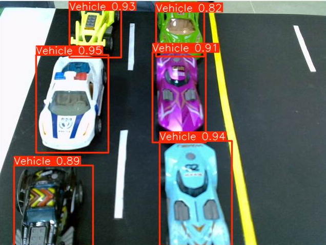
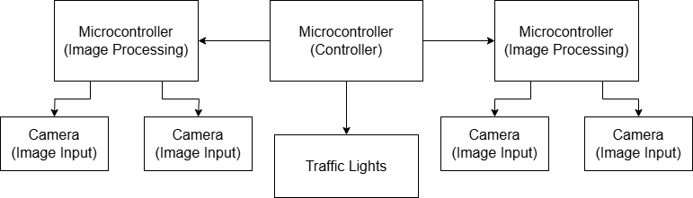

# Smart Traffic Lights

Adaptive traffic lights that count vehicles with YOLOv5n on two Raspberry Pi boards and give green time to the lanes that need it, with priority for emergency vehicles.



**Demo video:** [media/demo-1.mp4](media/demo-1.mp4) (more: [demo-2](media/demo-2.mp4), [demo-3](media/demo-3.mp4))

## Features

- Real-time vehicle counting per lane with a custom-trained YOLOv5n model.
- Green time scales with the number of cars in the lane; empty lanes are skipped and a busy lane is extended when every other lane is empty.
- Emergency vehicle detection with a second YOLOv5n model: all timers are cancelled, the lane turns green and stays green until the vehicle has passed.
- Two Raspberry Pi 4 boards linked over TCP: the controller handles lanes N and W, the worker handles lanes S and E.
- Four 3-colour traffic lights driven directly from GPIO.

## Hardware and stack

- 2 x Raspberry Pi 4 Model B
- 4 x USB cameras (one per lane), mapped by fixed USB port so indexes survive reboots
- 4 x traffic light LED modules on GPIO (BCM pins listed in `TrafficControl.lights`)
- Python, PyTorch, YOLOv5n (Ultralytics, via `torch.hub`), OpenCV, RPi.GPIO, sockets + pickle
- Datasets labelled in Roboflow, models trained on Google Colab

## How it works



1. The controller (Pi 1) sends `process_traffic` to the worker (Pi 2), then captures and runs inference on lanes N and W.
2. The worker does the same for lanes S and E in parallel.
3. The controller requests `traffic_data` and receives `(S count, S emergency, E count, E emergency)` as a pickled tuple.
4. If any lane has an emergency vehicle, the current lane goes yellow, the emergency lane goes green, and it keeps polling that lane until the vehicle is gone.
5. Otherwise a timer cycles the lights counter-clockwise (N, W, S, E), giving 5 to 25 s of green depending on the vehicle count and switching early if the current lane empties.

| File | Runs on | Role |
|---|---|---|
| `SmartTrafficLights.py` | Pi 1 (controller) | Inference on N and W, light control, decision logic |
| `command_sender.py` | Pi 1 (controller) | TCP client that sends commands to Pi 2 |
| `command_listener.py` | Pi 2 (worker) | TCP server on port 6001, inference on S and E |

More media: [emergency detection](media/yolo-emergency.png), [GPIO wiring](media/wiring.png), [camera connections](media/camera-connections.png), [intersection concept](media/intersection-concept.png).

## Build and run

1. On both Pis:
   ```bash
   pip install -r requirements.txt
   ```
2. Model weights are not in this repo. Put your own `YOLOv5n_VehicleCount3.pt` and `YOLOv5n_EmergencyVehicle3.pt` next to the scripts. To train them, label a vehicle dataset (single class `Vehicle`) and an emergency vehicle dataset in Roboflow, then train with the [Ultralytics YOLOv5](https://github.com/ultralytics/yolov5) repo:
   ```bash
   python train.py --img 640 --batch 16 --epochs 100 --data data.yaml --weights yolov5n.pt
   ```
3. Set the worker's IP address in `SmartTrafficLights.py` (`PI2_IP_ADDRESS`) and adjust `USB_CAMERAS` to your camera ports (`udevadm info --name /dev/videoX`).
4. Start the worker first, then the controller:
   ```bash
   # Pi 2
   python3 command_listener.py
   # Pi 1
   python3 SmartTrafficLights.py
   ```

## My role

I worked on all parts of the project with the team:

- Python code for the controller and worker Pis, the TCP command link and the light timing logic.
- Datasets and training of the two YOLOv5n models.
- Camera field of view and placement: one camera per side of the intersection so each lane is visible from above.
- Built the final prototype on a wooden board: intersection layout, poles for cameras and lights, and all wiring.
- Testing and debugging of the full system on the prototype.

## Results

- Working scale prototype with toy cars: lights adapt to lane occupancy and react to the emergency police car in real time.
- Both custom YOLOv5n models (vehicles and emergency vehicles) run on the Raspberry Pi boards themselves, with no external GPU.

## Team

- Sergio Azizi
- Daniel Berbary
- Bakr El Achkar

Supervisor: Eng. Fady Rouphael

ELCP392 Senior Design, Faculty of Engineering, University of Balamand. October 2024 to May 2025.
